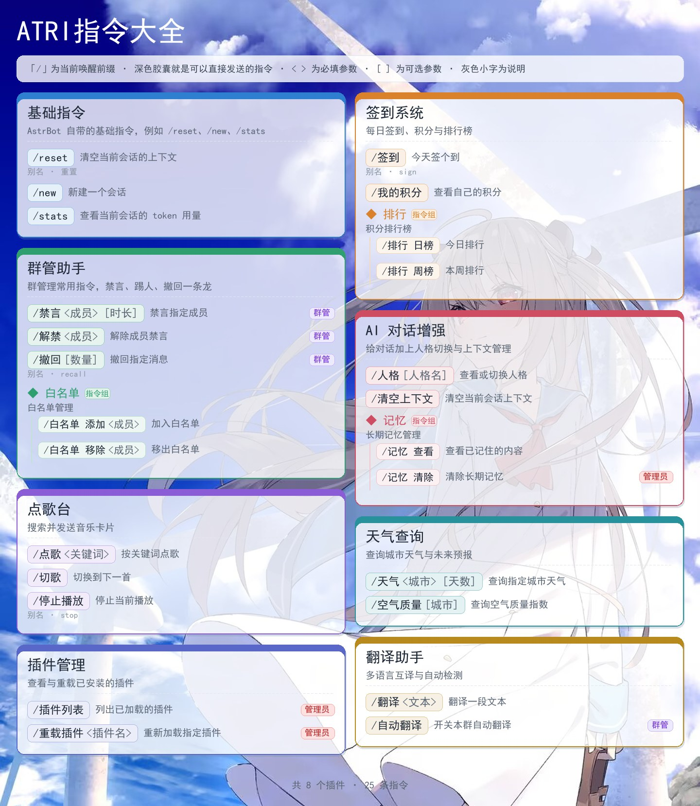

<div align="center">


# ATRI指令大全

[](https://github.com/AstrBotDevs/AstrBot)
[](https://www.python.org/)
[](LICENSE)

</div>

给 [AstrBot](https://github.com/AstrBotDevs/AstrBot) 加一个**统一的指令查询入口**：只注册一个指令，发送后自动抓取当前所有已加载插件的指令，在**本机渲染成一张卡片图**发出来。不依赖远端 T2I 服务，离线也能出图。

本项目基于 [AcceleratorYue/astrbot_plugin_command_help](https://github.com/AcceleratorYue/astrbot_plugin_command_help) 修改而来，沿用上游的指令采集、兜底与本地渲染思路，并加入 ATRI 主题底图、按身份过滤管理指令、隐藏规则等改动。

```text
/指令大全        ← 别名：/帮助、/指令帮助、/指令列表
```

> 唤醒前缀跟随 AstrBot 的 `wake_prefix` 配置（如 `/`）；也可以 @机器人 后直接发 `指令大全`。



> 预览图使用示意数据，实际内容取决于你安装的插件。

## 特性

- **一个指令**：`/指令大全`，不会和其他插件抢指令名。
- **自动汇总**：扫描所有已加载插件，每个插件一张卡片；卡片显示插件名称与简介。
- **完整指令信息**：指令组与子指令树状展开；显示 `[可选参数]`、`<必填参数>`；显示别名；管理员 / 群管指令带权限角标。
- **按身份展示**：发送前先鉴权。AstrBot 管理员可看到完整的指令图；普通用户不会看到仅管理员 / 群管可用的指令。
- **自定义隐藏**：在插件设置页添加「隐藏规则」，可按插件挑选不想展示的指令，也可隐藏整个插件。
- **不含自己**：图中不会出现「ATRI指令大全」自己的卡片，只列其他插件的指令。
- **尊重运行时状态**：WebUI 里禁用或重命名的指令以实际生效的名称为准（优先走 AstrBot 官方指令管理接口）。
- **本地出图**：Pillow 直接绘制，不依赖任何在线渲染服务；自适应两栏卡片（可配 1~3 栏）。
- **ATRI 主题**：使用插件目录内的 `ATRI.jpeg` 作为整张图的底图，自动等比缩放并居中裁剪；卡片与图例使用半透明背景，底图会隐约透出。底图缺失时自动退回纯色背景。
- **内容级缓存**：只要本次要渲染的插件、指令、标题、栏数、别名开关、唤醒前缀、隐藏规则等内容没有变化，就直接复用上一张图，不再按秒数过期。
- **跨平台字体**：优先使用 Linux 常见的 Noto Sans CJK / 思源黑体 / 文泉驿 / Droid Sans Fallback 等中文字体，并自动扫描系统字体目录；Windows / macOS 再回退到 SimHei / 苹方。
- **轻量安全**：只读采集，不改动任何插件数据；图片写入 AstrBot 临时目录并自动清理旧图。

## 与上游项目的差异

本项目不是上游的官方分支，而是独立维护的修改版。核心采集与渲染逻辑来自上游，主要差异如下：

| 项目 | 上游 | 本项目 |
| --- | --- | --- |
| 插件标识 | `astrbot_plugin_command_help` | `astrbot_plugin_atri_command_help` |
| 显示名 | 指令大全 | ATRI指令大全 |
| 视觉风格 | 蓝色渐变标题条、纯色卡片 | ATRI 底图、半透明卡片、顶部仅保留标题与图例，页脚不再显示生成时间 |
| 图标 | 上游 `logo.png` | 新的 ATRI 主题图标 |
| 卡片内容 | 徽标、插件名、版本、作者、内置标记、简介 | 插件名与简介 |
| 展示内容 | 包含「指令大全」自身 | 自动摘掉「指令大全」自身 |
| 权限处理 | 按配置过滤管理员指令 | 发送前按身份鉴权，普通用户自动隐藏管理员 / 群管指令 |
| 隐藏规则 | 无 | `exclude_rules`，可按插件或指令裁剪 |
| 字体 | Windows 字体优先 | Linux 中文字体优先，并跨平台扫描兜底 |
| 图片缓存 | 单张短时缓存 | 按实际渲染内容的指纹复用；内容不变时不重绘 |
| 临时文件 | `command_help_*.png` | `atri_command_help_*.png`，避免与上游互相清理 |
| 文档与维护 | 上游维护 | 独立 README、CHANGELOG 与版本线 |

> 上游项目地址：<https://github.com/AcceleratorYue/astrbot_plugin_command_help>。上游的功能建议与问题请反馈给上游；本项目的改动与问题请反馈到本仓库。

## 安装

### 方式一：WebUI 上传

1. 下载本仓库，压缩 `astrbot_plugin_atri_command_help` 文件夹为 zip。
2. 打开 AstrBot WebUI →「插件管理」→ 从本地安装/上传，选择该 zip。
3. 重载插件，发送 `/指令大全` 验证。

### 方式二：手动复制

把本目录放到 AstrBot 的插件目录下：

```text
<AstrBot 根目录>/data/plugins/astrbot_plugin_atri_command_help/
```

目录内需包含 `main.py`、`metadata.yaml` 与 `ATRI.jpeg`（AstrBot 的标准插件结构），然后重载插件或重启 AstrBot。

### 依赖

只需要 `Pillow`（AstrBot 自带了 Pillow；若提示缺失，在插件管理里安装本插件的 `requirements.txt` 即可）。字体优先使用 Linux 常见的 Noto Sans CJK / 思源黑体 / 文泉驿 / Droid Sans Fallback，并会自动扫描系统字体目录；Windows 开发机回退到系统自带的 `SimHei`，不需要随仓库分发字体。

## 使用与配置

发送 `/指令大全` 即可。可配置项（WebUI → 插件管理 → ATRI指令大全）：

| 配置 | 默认 | 说明 |
| --- | --- | --- |
| `title` | ATRI指令大全 | 图片顶部大标题 |
| `include_builtin` | 开 | 是否包含 AstrBot 内置指令（`/reset`、`/new`、`/stats` 等） |
| `include_admin_only` | 开 | 管理员自己查看时是否显示仅管理员/群管可用的指令；普通用户始终看不到这些指令 |
| `show_aliases` | 开 | 是否显示指令别名 |
| `columns` | 2 | 卡片列数，1=单列长图，2=左右两栏，3=三栏紧凑 |
| `exclude_rules` | 空 | 隐藏指定插件的指定指令；在设置页点「添加」逐条配置 |

> 图片缓存不使用过期时间：只要本次要渲染的插件、指令、标题、栏数、别名开关、唤醒前缀与隐藏规则等内容没有变化，就会直接复用上一张图。

### 隐藏规则（`exclude_rules`）

插件设置页里的「隐藏指定插件的指令」是一个可增删的规则列表，每条规则包含：

- **插件**：填插件显示名（如 `ATRI指令大全`）或目录名（如 `astrbot_plugin_atri_command_help`），支持 `*` 通配，`*` 表示所有插件。
- **要隐藏的指令**：填指令名，多个用逗号分隔（如 `reset, stats`）；指令组的子指令也可以单独隐藏。留空或填 `*` 表示隐藏该插件的全部指令。

例如：插件填 `演示插件`、指令留空，就会把整个「演示插件」的卡片从图里去掉；插件填 `演示插件`、指令填 `重置会话, 同步数据`，则只隐藏这两条指令。

> 该配置也兼容旧式写法：直接填写多行文本，每行一条 `插件名: 指令A, 指令B`。

## 工作原理

采集分两条路，优先走官方接口：

1. **官方指令管理**（AstrBot 4.29+）：调用 `astrbot.core.star.command_management.list_commands()`。它已经处理了指令组 / 子指令 / 别名 / 权限，并且尊重 WebUI 里的指令重命名与禁用状态。
2. **兜底**：直接遍历 `astrbot.core.star.star_handler.star_handlers_registry`，自己解析 `CommandFilter` / `CommandGroupFilter`。官方接口不可用（旧版本、数据库未就绪等）时自动切换，并注意跳过子指令 handler，避免重复列出。

插件名称与简介来自各插件的 `metadata.yaml`（运行时优先用 `star_map` 中的元数据）。采集结果会先按身份与配置过滤，再摘掉「ATRI指令大全」自身，最后按隐藏规则裁剪。出图完全由 Pillow 在本地完成：通常 1 秒内即可生成一张包含十几个插件、上百条指令的图片。

## 已知限制

- 只收录通过 `@filter.command` / `@command_group` 注册的指令；用正则监听或只挂事件钩子的隐式触发不会出现在图里。
- 多个插件注册同名指令时，AstrBot 本身会让它们都触发，本插件只是如实列出。

## 项目结构

```text
astrbot_plugin_atri_command_help/
├─ main.py              # 采集、过滤、Pillow 渲染与指令入口
├─ metadata.yaml        # AstrBot 插件元数据
├─ _conf_schema.json    # WebUI 配置项与隐藏规则 schema
├─ requirements.txt     # Pillow
├─ ATRI.jpeg            # 底图（缺失时自动退回纯色背景）
├─ logo.png             # 插件市场 / 插件页图标
├─ README.md
├─ CHANGELOG.md
└─ LICENSE
```

## 本地验证

本仓库暂未附带自动化测试脚本。修改后可把仓库放到 AstrBot 的 `data/plugins` 下，重载插件并发送 `/指令大全` 验证：

- 分别用管理员和普通用户测试，确认管理员指令的可见性符合预期。
- 连续发送两次，确认内容未变化时第二张图直接复用；重载插件或修改配置后应重新生成。
- 在设置页添加一条隐藏规则，确认对应插件或指令从图中消失。
- 确认图中不再出现「ATRI指令大全」自己的卡片。
- 临时移走 `ATRI.jpeg`，确认底图缺失时能正常退回纯色背景。

渲染核心只依赖 Pillow；也可以在自己的 Python 环境中导入 `main.py` 的 `render_command_image()`，传入构造好的 `PluginSection` 列表做离线出图检查。

## 上游与许可

- 上游项目：[AcceleratorYue/astrbot_plugin_command_help](https://github.com/AcceleratorYue/astrbot_plugin_command_help)
- 本项目仓库：<https://github.com/HoshimiSenya/astrbot_plugin_atri_command_help>
- 许可证：[MIT](https://github.com/HoshimiSenya/astrbot_plugin_atri_command_help/blob/main/LICENSE)

本项目保留上游的 MIT 版权声明，并在其基础上添加本项目的修改版权。`ATRI.jpeg` 仅作为插件默认底图使用，如你自行分发或商用，请自行确认素材授权。